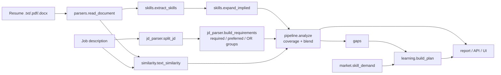

# Architecture

## Modules

| Module | Responsibility |
|---|---|
| `skills.py` | Taxonomy loading, alias matching with positions, implication closure, prerequisites |
| `jd_parser.py` | Split required vs preferred; build requirements with "or" groups |
| `parsers.py` | Text from txt/md/pdf (pypdf)/docx (standard library) |
| `similarity.py` | TF-IDF cosine (default) and optional sentence-transformer similarity |
| `pipeline.py` | Coverage, score blending, gap list; flags for ablation studies |
| `learning.py` | Prerequisite-aware ordering (topological sort with priority), effort, resources |
| `market.py` | Skill demand across a set of job descriptions |
| `evaluation.py` | Metrics, baselines, ablation, cross-validated weight tuning |
| `service.py` | One entry point shared by CLI, API and UI |

## Design decisions

- **Rules plus a taxonomy instead of a black-box model.** Every score can be explained skill by skill. The cost is recall on skills that are described rather than named.
- **Implications are explicit data** (`implies` in `skills.json`), so they can be reviewed and corrected without touching code.
- **OR groups require the same category** so "Python or Docker" is not treated as alternatives, at the cost of missing some unusual groupings.
- **Missing sections renormalise the weights**, so a JD without a nice-to-have list is not penalised or rewarded.
- **Evaluation is part of the codebase**: the benchmark runs in tests and CI, so a change that damages ranking quality fails the build.
- **One service layer** keeps the CLI, API and UI thin; the logic is tested once.
- **Optional dependencies** (pypdf, sentence-transformers) are imported lazily so the core runs with only scikit-learn and numpy.

## Known weaknesses

- The learning plan's hour estimates and resources are curated by hand and are rough.
- `Top-1 role` accuracy is saturated (1.00) on the bundled data, so it does not separate systems.
- Weight tuning on 56 pairs is noisy; defaults were set a priori and kept.
